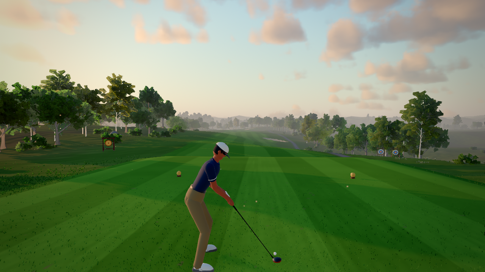

# Thornbury Links: physics golf in the browser

A hard, skill-based 3D golf game that runs in the browser. It is built with **Three.js, TypeScript and Vite**. You swing by physically dragging the golfer's hands with the mouse. The club has real weight, and the shot depends on your hand speed and path, your face and path settings, and how cleanly you strike the ball. It is an original game inspired by the mechanics of *Normal Golf Game*. See [CREDITS.md](CREDITS.md).



## Play

```bash
npm install
npm run dev        # open the printed URL, then click "Play 9 Holes"
```

- `npm run build` writes a static `dist/` folder that runs from any static host. The base path is relative.
- `?play=N` starts directly on hole N+1. For example, `?play=0` is hole 1.
- **F3** toggles the performance overlay.

**GitHub Pages:** `.github/workflows/pages.yml` runs the tests, builds the game and deploys `dist/` on every push. To enable it, open the repository's **Settings → Pages → Source** and choose **GitHub Actions**.

## How to swing (mouse)

1. You start in **golf stance** on the tee. **Tab** switches between stance and first-person walking.
2. **Hold the left mouse button and drag the golfer's hands.** In the swing panel the target is on the **right**. Drag **up and left** for the backswing, then **swiftly down and right** through the ball.
   - **Speed and smoothness** set the clubhead speed.
   - **How far out you swing** sets the contact. Stay on the green ring in the swing panel.
3. Shape the shot:
   - **A / D** close or open the clubface. This sets where the ball **starts**.
   - **Q / E** swing in-to-out or out-to-in. Face against path sets the **curve**.
   - **Z / C** aim. **W / S** move the ball back or forward in your stance, for higher or lower shots.
   - The face and path wobble slightly while you swing, so keep them square.
4. Clubs: **1–5** select Driver, Hybrid, Iron, Wedge or Putter.
   - With the wedge and the putter, a full mouse swing makes only a short stroke, so soft shots are easy to control.
   - For putts, the **backstroke length sets the distance**, and a live hint shows how far it will roll.
5. While the ball is in the air, **move the mouse to look around**. **W/S** zooms and **F** fast-forwards. When the ball stops you are taken straight to it.

See [CONTROLS.md](CONTROLS.md) for every input, the gamepad mapping, and the improvements over the original scheme. Each improvement can be switched off in Settings.

## What's inside

| Area | Highlights |
|---|---|
| Ball physics (`src/physics`) | D-plane impact model, drag and Magnus lift fitted to TrackMan tour data (±3%), turf bounce with spin (Penner), slope-aware rolling on stimp-10 greens, cup capture and lip-outs, water and out-of-bounds |
| Swing (`src/swing`) | Physics-driven hands and a weighted club with a wrist hinge. Speed, attack angle, fat, thin and topped shots emerge from your motion. |
| Course (`src/course`) | Original 9-hole, par-35 layout on a 1.6 km landscape, built from signed-distance shapes and noise heights, baked in Web Workers |
| Rendering (`src/render`) | Instanced GPU grass with wind, splat terrain with mowing stripes, volumetric clouds, IBL, reflective water, procedural trees with impostors, a procedural golfer and clubs, Rapier props, and post-processing (AgX, bloom, N8AO, SMAA, DoF) |
| Game (`src/game`, `src/ui`, `src/audio`) | Round flow, penalties and scorecard, timer and best scores, menus and settings, key rebinding, gamepad, procedural audio |

## Development

| Command | Purpose |
|---|---|
| `npm test` | Vitest: physics calibration, swing model, putting, drift, max distance, course, rules, camera, input, props |
| `npm run typecheck` | TypeScript, strict mode |
| `node scripts/screenshots.mjs OUT views PORT` | Fixed-view screenshots (`tee,fairway,green,water,wide,grass`) |
| `node scripts/e2e-controls.mjs PORT` | Playwright test of the real controls |
| `node scripts/playtest.mjs PORT 0,2` | Plays holes 1 and 3 start to finish |

## Docs

- [RESEARCH.md](RESEARCH.md): research on the original game's controls and mechanics, player sentiment, and tech choices
- [DECISIONS.md](DECISIONS.md): every design and tech decision, including changes made from user feedback
- [CONTROLS.md](CONTROLS.md): all inputs
- [PROGRESS.md](PROGRESS.md): status, known issues and next steps
- [CREDITS.md](CREDITS.md): libraries and licences
